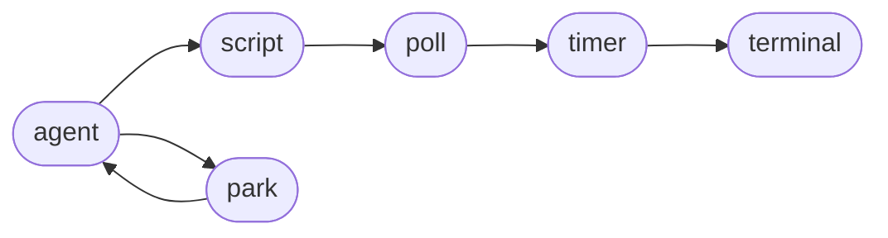
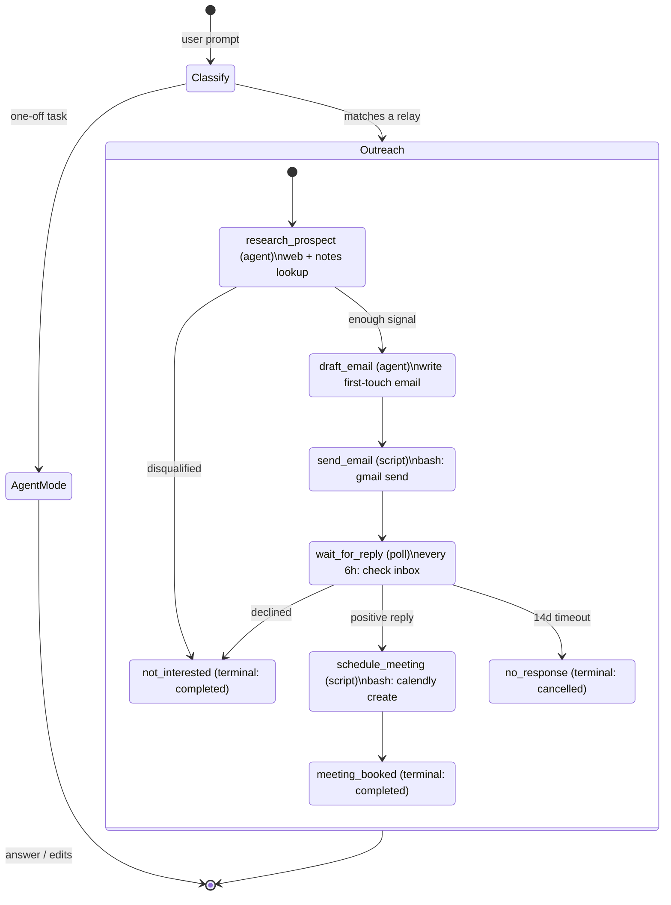
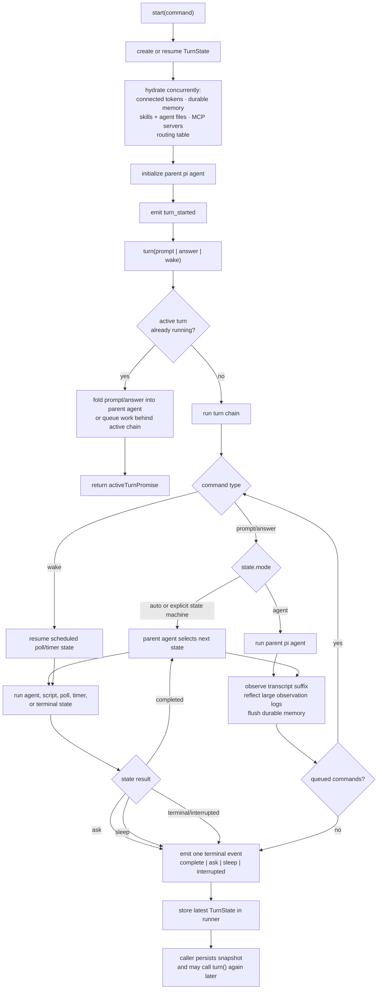

# Relay Pi

[](LICENSE)
[](https://bun.sh)

**为超出单次对话时长的工作而构建的 Agent harness。**

怎样才能让 Agent 持续工作，直到任务完成？大多数 harness 没有答案——对话结束，进程退出，上下文也随之消失。Relay Pi 有三种办法。会话可以暂停几分钟，也可以暂停几个月；之后在全新的沙箱中继续，而不会丢失上下文。

```bash
bun install
bun run cli -- "prospect the VP Eng at Acme, send a first-touch email, and book a meeting if they reply"
```

Relay Pi 尚未发布到 npm；目前请从代码检出目录运行，或在构建包发布后安装。模型请求通过 OpenRouter 发送：请在环境变量、`<workdir>/.env` 或 `~/.relay-pi/.env` 中设置 `OPENROUTER_API_KEY`（见 [CLI 环境设置](#cli-env-setup)）。

## 超出单次对话的工作

- **长期外联与生命周期管理。** 潜在客户 → 发送邮件 → 等待 14 天 → 预约 → 交接。relay 可以在没有常驻进程的情况下，于 `wait_for_reply` 停留一周。
- **不会遗忘的编程会话。** 一个月后继续重构时，Agent 仍能记住曾经尝试过什么、哪些做法有效，以及你明确要求它不要再做什么。
- **有据可查的多步骤研究。** 每一步都是可观察的状态——Agent、脚本、轮询——而不是黑盒调用链。也可以从中途开始：“研究我已经做完了，只要起草邮件。”
- **无服务器和沙箱化回合。** 回合之间只需保留 `TurnState`。Cron 唤醒任务、运行一轮、持久化状态，然后退出。
- **缓慢、定时、周期性任务。** 冷启动外联、每周摘要、审查周期、定时重试、长时间迁移——任何下一步要等几小时或几天的工作。

如果工作能在一次对话里完成，你可能不需要它。如果不能，大多数 harness 都要求你自行准备记忆层、队列和恢复逻辑。Relay Pi 正是为了解决这一缺口。

## 为什么还需要另一个 harness？

大多数 Agent 框架擅长处理_一轮对话_，却不是为_完整任务_而设计。记忆是插件，持久进程需要“接入 Temporal”，从磁盘恢复则是事后补上的功能，最后往往令人后悔。真正有意思的部分——_跨回合记忆、从中断处继续，以及判断何时该询问、何时该继续_——都留给了使用者。

Claude Code 和 Codex 都非常擅长“一轮完成”的工作：编辑文件、运行命令、回答问题。Relay Pi 面向的是更上一层的工作——必须记忆、等待、在不同进程中恢复并自行选择下一步的任务。

|                                      | Claude Code                                                                                                         | Codex CLI                                                           | **Relay Pi**                                                                                                                                                     |
| ------------------------------------ | ------------------------------------------------------------------------------------------------------------------- | ------------------------------------------------------------------- | --------------------------------------------------------------------------------------------------------------------------------------------------------------- |
| **跨会话记忆**                       | `CLAUDE.md`（由用户编写）+ auto-memory（Claude 按仓库写入，每个会话最多加载前 200 行 / 25 KB）                     | `AGENTS.md`（由用户编写；子目录中可使用分层的 `AGENTS.override.md`） | **基于 PGlite 的观察式记忆与混合检索（pgvector + tsvector，通过 RRF 融合）。Agent 观察自身对话记录，并在不同会话间回忆信息。**                                      |
| **图像记忆**                         | 图像只保留在当前活动对话记录中                                                                                      | 图像只保留在当前活动对话记录中                                      | **支持视觉的模型会将截图和 UI 捕获内容转为文本观察记录，Agent 可在后续回合中回忆。**                                                                                |
| **在新进程中恢复**                   | `claude --resume <id>` / `--bg` 后台会话——重放已保存的对话记录                                                     | `codex resume <id>`——从 `~/.codex/sessions/` 重放已保存的对话记录   | **将 `TurnState` 快照保存在磁盘上；任何新进程——新的沙箱、无服务器调用或另一台机器——都可通过 `runner.start({ state })` 恢复。**                                      |
| **长期、多步骤工作流**               | 后台会话；没有原生的轮询/等待/状态机原语                                                                            | 由对话记录驱动；没有原生的轮询/等待/状态机原语                     | **Relays：由 Agent 驱动的状态机，包含五种状态——`agent`、`script`、`poll`、`timer`、`terminal`。两轮对话之间可以等待数天。**                                           |
| **模型路由**                         | 手动——用 `/model` 选择模型                                                                                         | 手动——用 `-m` 或配置选择模型                                      | **自动路由——分类器为每轮选择模型与思考强度，并可在回合中途重新路由；自定义路由表可选择启用 `ask_advisor` 工具。**                                                   |
| **可使用的模型**                     | Anthropic                                                                                                          | OpenAI（使用 ChatGPT 登录或 API key）                              | **OpenRouter，以及已连接的 ChatGPT/Copilot 计划**                                                                                                               |
| **许可证**                           | 专有（闭源 CLI）                                                                                                   | Apache-2.0                                                          | **Apache-2.0**                                                                                                                                                  |

这些差异并不意味着 Claude Code 或 Codex 在其擅长的领域表现更差；它们说明，当任务超出单次对话时，Relay Pi 更合适——例如记忆必须跨会话保留、进程需要等待外部信号，或回合要在工作开始时尚不存在的容器中恢复。

以下两点没有单独成节，但同样源于这种设计：

- **一个凭据，访问所有可用模型。** OpenRouter 提供精选模型目录，已连接的 ChatGPT/Copilot 计划可以承载其覆盖范围内的请求。
- **开源。** 没有黑盒。如果我们对记忆排序或 relay 路由做了错误决定，你可以阅读代码并指出问题。

## What we do differently

<a id="the-model-router--advisor"></a>

### 模型路由器与顾问

你不必亲自选择模型，只需选择一个层级。直接运行 `relay-pi` 会使用 `frontier` **虚拟模型**：低成本分类器读取每条提示词，根据任务类型（视觉、规划、实现、写作）选择具体模型与思考强度，并在回合过程中持续重新评估。因此，会话可以先用视觉模型读取截图，再切换到编程模型完成后端工作。缓存成本也会纳入判断，而不是通过迟滞逻辑处理：分类器会获知切换模型会丢弃 provider 提示缓存，并会被要求在工作类型不变时优先沿用当前模型；上下文压缩和重新路由被视为相互配合的节点——缓存已失效时才检查是否需要重新路由，切换模型时则向新模型提供压缩后的前缀。步骤输出也会反馈到路由中：若文本模型遇到图像输入，可以在回合中途切换到支持视觉的模型。

已发布的复合层级默认关闭顾问功能。新会话和恢复的会话使用当前路由配置；保存的顾问消息仍作为历史保留。显式配置的层级可以启用顾问，作为升级处理的出口。启用该功能的层级会注入一个无参数的 `ask_advisor` 工具，将整理后的部分对话记录——执行器系统提示词、首条用户消息，以及作为省略中间内容的实时记忆观察记录——发送给更强的模型。涉及重大架构决策、约束冲突和重要未知时必须咨询顾问；常规本地工作禁止调用。路由改变会提醒顾问重新评估，顾问咨询后也会触发重新分类。

保存的会话会保留模型家族选择，而[模型目录](src/model-resolution/catalog.ts)会更新其执行目标。恢复时保留对话记录中原始模型的归属信息，下一回合则根据当前目录解析。provider 选择会保留其传输方式，并在恢复时更新已知的替代目标；显式指定的其他模型仍具有优先权。加载已保存的路由表时，也会按相同规则恢复模型家族意图，因此 Agent 与 gateway 更新可以按任意顺序到达。虚拟层级、路由策略和磁盘配置的格式都不变。已保存的工作流定义也会按相同规则恢复可执行模型选择；对话记录与工作流审计历史保持不变。

所有判断依据都存在于文字中，而非代码：路由描述、切换缓存的偏好和顾问调用时机都可在路由表中编辑。因此，调整路由只需修改 `.relay-pi/models.json`，无需重新构建。`relay-pi route "<prompt>"` 会显示分类器实际会做出的决定；指定具体 `--model` 名称则会固定该模型并完全绕过路由。设计依据与不变量见 `specs/done/model-router/`。


### 融合式记忆

记忆与上下文压缩是同一个基础机制：观察式记忆就是上下文跨回合保留的方式。运行器会观察自身对话记录，在观察内容增长时进行反思，并将持久化记录写入 PGlite。消息和图像都会转换成文本观察，因此截图和 UI 捕获内容无需重新附加字节，也能在后续回合中回忆。每回合的提示词前缀只会在明确的刷新节点重新生成：会话开始或显式重新加载技能时，从项目目录祖先加载精选记忆文件；发生压缩事件时，才重建长期记忆和当前会话观察记录。这样的分层能让训练知识保持确定性，避免挤占观察式记忆，并在不同回合间保留 provider 提示缓存。冻结前缀以外的数据库观察仍可通过 `recall_memory` 访问：该工具结合 pgvector 余弦相似度和 tsvector 关键词搜索，并通过 Reciprocal Rank Fusion 融合结果，还可选用改写查询来扩展搜索。Embedding 在后台 worker 中生成，因此不会阻塞前台回合。

### Relays：让 Agent 持续工作直至任务完成

Relay 是 Relay Pi 跨越数小时、数天乃至数月持续处理任务的方式。底层是状态机，但每回合由运行器 Agent 而非配置文件选择下一次状态转换。它提供足够的结构来驱动长期工作，又不会把 Agent 锁定在固定路径中。每个状态属于以下六种类型之一：

- **agent** — 带有提示词、可选系统提示词及可选技能允许列表的子 Agent。
- **script** — 调用 `bash`、`curl` 或 CLI 等外部命令；任何可通过 API 完成的工作都可以放在脚本状态中。
- **poll** — 定期检查外部信号，例如收件箱、构建状态或 webhook。
- **timer** — 等待至指定的绝对时间，不附带脚本。
- **park** — 暂停运行，由主 Agent 决定下一步：可以等待人工确认，也可以由主 Agent 自行继续。park 不会安排唤醒，因此运行器会在回合结束前执行一次提醒检查；等待人工输入是合理状态，但忘记转换不是。
- **terminal** — 记录业务结果：`completed`、`cancelled` 或 `failed`。



这就是全部状态类型。Email、GitHub、Calendly、CRM 等都无需成为引擎的一等概念；它们可以由 shell 脚本实现。Relay 也可以从中间状态开始（例如“我已经发过邮件了，只需等待回复”），因为运行器 Agent 读取的是上下文，而不是工作流 ID。

> [!NOTE]
> 这**不是** Temporal：它不是确定性 DAG、精确一次运行时或工作流服务。它只提供足够的结构，让 Agent 做出合理的流程决策；需要运维级保证时，应交由外部系统负责。

### 磁盘状态，默认支持无服务器运行

一个回合是 `TurnState` 的纯函数。回合运行期间由运行器在进程内持有状态；回合之间则由持久化机制将其保存到磁盘。任何进程——明天启动的同一 shell、新沙箱、无服务器调用或另一台机器——都可以通过调用 `runner.start({ state })` 从上次中断处继续。无需粘性 worker、预热池或会话亲和性。Cron 唤醒容器、传入状态快照、运行一轮、持久化并退出；需要时的部署方式就是如此。

### 三种模式：agent、relay、auto

同一个运行器支持两类工作。`agent` 模式将提示词视为普通会话，用于编程、研究、审查等一次性任务。`state_machine` 模式（在 UI 中显示为 **relays**）会把提示词交给由 Agent 驱动的业务流程，支持持久等待并记录最终结果。`auto` 模式由运行器判断提示词类型并选择模式。一个 CLI、一个 SDK；长任务和短任务走同一条代码路径。


## 架构

一个由 Agent 驱动的真实 relay 示例：会议外联。用户提示词进入 `TurnRunner`，运行器 Agent 根据提示词、历史记录和可用状态选择下一状态，relay 随后驱动业务流程，直至到达终止状态。同一流程定义也可以从中间状态开始——例如用户说“我已经发过邮件”，运行器就可以直接进入 `wait_for_reply`。

<details>
<summary><b>完整架构图</b>（点击展开）</summary>



</details>

观察式记忆、pi 编程工具和防护机制支撑每一次状态转换；它们本身不是状态。


_一条提示词，就能启动可持续数周、数月甚至数年的任务。Relay Pi 将状态机的能力以 relay 的形式带给 Agent。_

## 其他能力

<details>
<summary><b>可选防护机制</b></summary>

基于模式的防护（快速、使用正则表达式）和语义防护（由 LLM 评估）可组合成防火墙。每条 bash 命令和每次文件写入都可以在执行前接受检查。

```typescript
const turnRunner = new TurnRunner({
  guardrails: [
    {
      kind: "pattern",
      rules: [
        { pattern: /production-db/i, action: "warn", reason: "Production database mentioned" },
      ],
    },
    {
      kind: "semantic",
      model: getModel("anthropic", "claude-haiku-4-5"),
      policy: "Never delete production data. Never expose secrets in output.",
    },
  ],
});
```

</details>

<details>
<summary><b>远程 MCP 工具</b></summary>

`TurnRunner` 可以通过可流式传输的 HTTP（streamable-HTTP）传输方式连接远程 [Model Context Protocol](https://modelcontextprotocol.io) 服务器。调用 `start` 时传入 `mcpServers`，运行器就会连接服务器、列出各服务器的工具，并将这些工具与内置编程工具一起提供给主 Agent 和各状态 Agent。工具名称会命名为 `{server}__{tool}`，以便多个服务器同时使用而不发生冲突。

```ts
await turnRunner.start({
  mcpServers: {
    docs: {
      type: "http",
      url: "https://mcp.example.com/docs",
      headers: { "x-api-key": process.env.DOCS_KEY! },
    },
  },
});
```

目前仅支持 HTTP MCP；认证不在支持范围内，因此服务器所需凭据必须通过 `headers` 传递。连接失败时会记录日志并跳过，这样单个服务器故障不会阻塞会话初始化。

</details>

<details>
<summary><b>原生中断</b></summary>

中断行为由底层 pi agent 运行时提供。pi 会话运行期间，用户可以发送消息；运行时可将其作为中断或后续消息处理。Relay Pi 不会在此基础上再添加第二套中断总线。

</details>

<details>
<summary><b>Pi 编程工具</b></summary>

子 Agent 使用 `@earendil-works/pi-coding-agent` 提供的默认工具：read、bash、edit 和 write。回合运行器会提供工作目录，并可限制状态机 agent 状态所注入的技能；它不会再用另一层沙箱抽象包装这些工具。

</details>

## 安装

Relay Pi 尚未发布到 npm。目前可从代码检出目录运行：

```bash
bun install
bun run cli -- "your prompt"
```

CLI 基于 Bun 原生运行，因为 OpenTUI 需要 Bun；未来发布的软件包将安装 `relay-pi` 可执行文件。

<details>
<summary><b>升级方式</b></summary>

在 `relay-pi` 发布正式版本之前，`relay-pi upgrade` 会保持禁用。发布后才设置 `RELAY_PI_UPGRADE_ENABLED=1`；之后该命令会检测包管理器并安装新版本。

</details>

<details>
<summary><b>开发环境配置</b></summary>

本仓库使用 Bun 管理包、使用 Husky 执行提交前检查，并使用 Docker 运行功能测试。

```bash
bun install
bun run setup        # install/start Docker on macOS or Linux if needed
bun run check-types
bun run lint
bun run eval         # runs live evals inside Docker
bun run test         # runs the test suite inside Docker
```

请以 `bun run test` 和 `bun run eval` 为准，不要直接运行原始 `bun test`。会写入文件的测试和 eval 在 Docker 中运行，因此在主机上执行定向测试不会在代码检出目录中创建 `.relay-pi`、PGlite 数据库或 home 目录下的技能 fixture。

[工作流结果夹具](evals/fixtures/workflow-reliability/README.md)为 CLI eval 与已部署的验收流程提供共享且独立的行为 oracle。

需要付费的评测基础设施及其独立验证命令见 [SWE-bench 基准测试](benchmarks/swebench/README.md)。

提交前 hook 会运行 `format`、`check-types` 和 `lint`。

</details>

## CLI 快速开始

Relay Pi 会从环境变量或 env 文件读取 `OPENROUTER_API_KEY`。运行 `relay-pi env --keys` 可将它写入共享文件。

```bash
relay-pi env --keys
relay-pi "prospect the VP Eng at Acme, send a first-touch email about our conf talk, wait up to 14 days for a reply, and book a meeting on Calendly if they're interested"
```

**连接你已有的订阅。** 运行 `relay-pi connect chatgpt`（或 `copilot`），通过 OAuth 设备码关联 ChatGPT 或 GitHub Copilot 计划。已连接订阅作为传输通道，而非额外模型：模型目录保持不变，计划覆盖的模型会自动通过订阅运行，计费显示为 `$0 · plan`；额度耗尽时会显示会话通知并回退到 gateway。可用 `relay-pi connect --status` 和 `--disconnect <provider>` 管理连接；令牌只保存在 `~/.relay-pi/connected-providers.json`（权限为 0600）。设计依据和不变量见上游 relay-pi-agent 仓库的 `specs/connected-providers/`。

<details>
<summary><b>Provider、模型与 CLI 参数</b></summary>

Relay Pi 通过 OpenRouter 发送按量计费的模型请求（`OPENROUTER_API_KEY`）。对于已连接的 ChatGPT 和 Copilot 计划，系统会优先使用它们覆盖的模型。请在环境变量、`<workdir>/.env` 或 `~/.relay-pi/.env` 中设置密钥。

省略 `--model` 时，`relay-pi` 会运行经过路由的 `frontier` **虚拟模型**——路由器与顾问的工作方式见[模型路由器与顾问](#the-model-router--advisor)。参数和配置如下：

- `--model frontier|balanced` 显式选择路由层级；任何具体模型名都会固定该模型并绕过路由。
- `relay-pi config export` 会将路由表写入 `.relay-pi/models.json`（包含路由、思考强度、顾问策略、`stepTriggers` 关键词及每条路由的 `visionFallbackModelName`）；`/route` 用于检查实时会话。
- 覆盖文件的发现方式与技能相同：从工作目录向上查找时，最近的 `.relay-pi/models.json` 优先；全局后备路径为 `~/.relay-pi/models.json`。每个文件都会完整替换配置，不会合并。
- 如果一个层级内的所有路由最终都指向相同的模型与思考强度，就不会调用分类器。

使用 `--provider openrouter` 可固定路由器的具体默认 provider，而无需选择模型：

```bash
relay-pi --provider openrouter "explain this repo"
```

`--provider` is mutually exclusive with `--model` / `--memory-model`.

```bash
export OPENROUTER_API_KEY=...

relay-pi "build a REST API with Express"
relay-pi                                                                  # interactive TUI
relay-pi -m opus-5.5 --workdir ./my-project "refactor the auth module"
relay-pi --memory-model sonnet-4.6 "summarize this repo"
relay-pi --system-prompt "Prefer concise answers." "review this repo"
relay-pi --system-prompt-file TEAM.md "review this repo"
relay-pi --no-system-prompt-files "review this repo"
relay-pi --resume session_abc123 --workdir ./my-project
relay-pi skills                                                           # list installed skills
relay-pi memory                                                           # browse durable memory

```

Model names can be a virtual tier (`frontier`, `balanced` — routed per prompt), a versionless family (`opus`, `sonnet`, `haiku`, `sol`, and others), full `provider:modelId` syntax, or a versioned shorthand such as `opus-5.5` or `gpt-6.1-sol`. Family names resolve to the latest curated version, while concrete shorthands resolve through OpenRouter or a connected plan that covers them; use full `provider:modelId` syntax to pin an exact model id.

</details>

<details>
<summary><b>交互式 TUI</b> — 对话记录、侧边栏面板、文件/技能选择器</summary>

在 TTY 中运行 `relay-pi` 会打开交互式 TUI：左侧显示实时对话记录，右侧边栏包含四个面板，底部是文本输入框。

- **todos** — 运行器当前的待办事项列表。
- **follow-ups** — 排在当前回合之后的提示词队列（工作状态行也会显示数量）。
- **relays** — relay（状态机）运行时，列出所有状态；当前状态用 `▶` 标记，并显示已到达的终止状态。
- **context** — 对照当前模型上下文窗口显示 token 用量进度条。

在输入框中：

- `@<query>` 会打开文件选择器；使用 ↑/↓ 浏览，按 Enter / Tab 插入 Markdown 链接，例如 `[app.ts](./src/tui/app.ts)`（标签为文件名，目标路径相对于仓库）。之后模型可通过 `read` 工具读取该文件。
- `/<query>` 会打开技能选择器，并插入 `/skill-name`，以便模型在当前回合中获得完整的 SKILL.md 指令。
- 按 Enter 发送消息； Agent 运行时按 **Shift+Enter** 会将消息排入后续队列，而不是引导当前回合。
- `Esc` 关闭当前选择器；单独按下时会中断正在运行的回合，空闲时则不执行操作。
- `Ctrl+C` 根据上下文处理，而不会立即退出：回合运行时中断该回合；输入框有文本时清空输入；空闲且输入框为空时先请求确认（“再次按 Ctrl+C 或按 Enter 退出”）。确认退出或关闭终端时，都会通过 SessionManager 完成清理，确保本地记忆数据库（PGlite）正确刷新。

工具调用会使用自定义的工具标题显示，例如 `$ <command>`、`read <path> (lines a–b)`、`edit <path> (N edits)` 和 `[question]`。恢复的会话也会使用相同格式化器呈现历史记录，确保实时显示与回放一致。

</details>

<details>
<summary><b>Slash 命令</b> — 会话内控制</summary>

在输入框中输入 `/` 打开命令选择器，或直接将以下任一命令作为消息发送：

- **`/model <name>`** — 切换后续回合所使用的模型。接受虚拟层级，以及与 `--model` 参数相同的模型家族名、带版本的简写和 `provider:modelId` 格式（例如 `/model frontier`、`/model sonnet`、`/model openrouter:openai/gpt-6.1-sol`）。具体模型名会固定模型并暂停路由；层级名会恢复路由。未知简写或缺少 provider 凭据时会报告错误并保留当前模型。正在运行的回合（如果有）继续使用其启动时的模型。使用 **`/route`** 检查实时路由状态。
- **`/thinking <level>`** — 切换下一回合的思考强度，可选值为 `minimal`、`low`、`medium`、`high`、`xhigh`。运行器会在使用时将其限制到当前模型支持的范围。正在运行的回合（如果有）保持原思考强度。
- **`/clear`** — 释放当前会话并启动一个新会话。
- **`/copy [last|all|<N>]`** — 将对话记录复制到系统剪贴板（默认复制 Agent 最近一次回复）。
- **`/paste`**、**`/image <path>`**、**`/clear-images`** — 用于添加图像附件，详见下一节。
- **`/diag`** — 排查终端专属问题时，切换按键和选择事件日志。

`/model`、`/thinking`、`/clear`、`/paste`、`/clear-images` 和 `/diag` 也可以出现在更长的提示词中。例如 `hey can you review this /model sol` 会为当前消息发送的回合切换模型；slash 命令会从 Agent 收到的内容中移除，因此模型只会收到 `hey can you review this`。如果整条提示词只包含 slash 命令，就不会启动 Agent 回合。接受行尾参数的命令（`/copy`、`/image`）只有在整条消息都属于该命令时才会执行。

非 TUI 的单次 CLI 调用也支持内嵌命令：`relay-pi "hey can you review this /model sol"` 会切换模型并将移除命令后的提示词发给 Agent；`relay-pi "/model sol"` 则只切换模型后退出，不会派发回合。

Slash 命令由本地拦截，不会传给模型；例外是选择器插入的 `/skill-name` 技能引用，此时运行器会在该回合内展开对应技能的完整 SKILL.md。

</details>

<details>
<summary><b>图像附件</b></summary>

交互式 TUI 支持图像附件（PNG、JPEG、GIF、WebP）：

- **Cmd+V / Ctrl+V** — 从剪贴板粘贴。需要支持 kitty 键盘协议的终端；其他终端可使用 `/paste`。
- **`/paste`** — 手动探测剪贴板。如果终端拦截了 Cmd+V（例如 Warp、macOS Terminal.app），请使用此命令。
- **`/image <path>`** — 通过绝对或相对路径添加磁盘上的图像。支持波浪号路径（`~/`）和 `file://` URL。

`/clear-images` 会移除所有待发送附件。附件缓存在 `~/.relay-pi/cache/paste/<session-id>/` 下，每张上限为 20 MB。在 macOS 上，剪贴板读取通过小型 Swift 程序（`swift -e`）完成，以便 Chromium 应用中的 promise-backed 粘贴板返回图像字节；如果看到 “clipboard had no readable image”，请使用 `xcode-select --install` 安装 Xcode Command Line Tools。

</details>

<details>
<summary><b>通过 CLI 查询、回忆和添加持久化记忆</b></summary>

运行器读取的 `~/.relay-pi/memory.db` 也可以通过 CLI 脚本化操作。直接运行 `relay-pi memory` 会打开交互式 TUI；添加 `--json` 或任意筛选条件后，同一命令会执行非交互式查询。以下三个子命令覆盖写入和搜索操作：

```bash
# Filter/query mode — bare array of canonical memory objects
relay-pi memory --json --type reflection --from 2026-06-26
relay-pi memory --json --source user --session sess_abc123     # rows authored by one session

# Recall — hybrid semantic + keyword search, same pipeline as the recall_memory tool
relay-pi memory recall wire byte budget cap                     # positional query
relay-pi memory recall --query "how does the gateway race resolve" --expand
relay-pi memory recall --scope global --session sess_abc123 --json qwiklabs

# Add — write a single user-authored note
relay-pi memory add --priority high --tag billing "Enterprise discounts cap at 20%"
echo "note from a pipe" | relay-pi memory add --source import --session sess_abc123 --json
```

三种操作共用同一种**规范记忆 JSON 对象**（`--json`），因此下游只需解析一种数据结构：

- 时间戳使用 ISO 8601 字符串（例如 `2026-07-06T00:00:00.000Z`）；仅日期字段（`observedDate`、`referencedDate`）使用 `YYYY-MM-DD` 格式。
- `source` 是一个字符串，可选值为 `user | agent | system | api | import`（`system` 表示来源于训练）。
- 观察记录的 `sessionId` 表示创建该记录的会话：数据库模式下可通过 `add` 写入，也可在 `memory`/`recall` 中筛选，并会在数据库输出中返回（旧记录和文件记忆中可能不存在）。
- 观察记录 JSON 会明确列出两个排序维度：`packScore`（新近度 × 优先级 × 类型偏置）和 `relevanceScore`（查询相关性，仅在 `memory recall` 中提供）。文件存储 JSON 则报告 slug 和存储路径，因为这些记录属于继承的上下文，而非排序后的回忆结果。

各命令说明：

- **`relay-pi memory`（查询）：** `--json` 输出按 pack score 排序的数组；除 `--type`、`--priority`、`--from` 和 `--to` 外，也可使用 `--source` 和 `--session` 缩小结果范围。
- **`relay-pi memory recall`：** 查询文本可通过 `--query <q>` 或位置参数传入。`--scope session|global` 要求同时提供 `--session <id>` 作为对照；默认值 `all` 会忽略该参数。`--json` 输出按相关度从高到低排列的数组，每项包含 `packScore` 和 `relevanceScore`。
- **`relay-pi memory add`：** 新增记忆始终属于 `note` 类型。不带参数的写入会进入最近的祖先目录 `.agents/memories`；传入 `--db` 可保留观察记录的排序、embedding 和会话归属能力。内容可通过位置参数或 stdin 提供；空输入会被视为用法错误。Agent 手动写入的文件也会被读取：存储会解析键顺序任意的纯 YAML frontmatter，根据文件自身路径和创建时间补全缺失的 `id`/`createdAt`，并在首次更新时将它们规范化后写回。

数据库模式的记忆命令接受 `--db <absolute-path>` 和 `--wait <seconds>`。`memory add` 还接受单个 `--store`；`memory recall` 则有意拒绝该选项，因为文件记忆已加载到 Agent 上下文中。退出码稳定，可用于脚本：`0` 表示成功，`64` 表示用法或验证错误，`75` 表示等待 memory-DB 锁的预算耗尽，`1` 表示其他错误。

</details>

<details>
<summary><b>将一组文档训练为持久化记忆</b></summary>

`relay-pi train <folder>` 会在指定目录中启动子 Agent，让它使用原生工具读取目录中的内容（Markdown、CSV、PDF、电子表格、截图、源代码等 Agent 能打开的文件），并生成两类产物：

- **一条可继承的 Markdown 记忆**，保存在最近祖先目录的 `.agents/memories` 存储中。显式指定 `--store` 可选择其他文件存储；显式指定 `--db` 则保留旧版高优先级手工记录行为。
- **`~/.relay-pi/train/<memory-id>/`** — 隐藏归档目录，保存源文件副本和私有来源信息。可共享的记忆 frontmatter 会引用归档 ID，但不会嵌入绝对源目录路径。

```bash
relay-pi train ./snowflake-notes              # writes to the nearest .agents/memories
relay-pi train ./snowflake-notes --slug snow  # custom slug (default: folder basename)
relay-pi train ./snowflake-notes --model opus-5.5
relay-pi train ./snowflake-notes --db /tmp/scratch.db  # write to a throwaway DB instead
```

重新运行 `train` 时，如果使用相同 slug，会替换所选后端中的旧条目及其归档。

需要注意三点：

- **当前会话不会监视新记忆文件。** 新文件会在新的 `relay-pi` 会话中出现，或在程序调用 `reloadSkills()` 刷新磁盘上下文后出现。
- **合成记忆需要 API key。** 可使用 `OPENROUTER_API_KEY`，或连接能够覆盖目标模型的 ChatGPT/Copilot 计划。
- **训练目录中的 `.env` 会被加载**（因此项目目录可提供自己的 provider 凭据）。训练不熟悉来源的目录前，请先检查其中的内容。

CLI 也会将观察内容输出到 stdout，因此可以通过管道处理：`relay-pi train ./docs | tee notes.txt`。

</details>

<a id="cli-env-setup"></a>

<details>
<summary><b>CLI 环境设置</b> — 使用你自己的 provider 密钥</summary>

`relay-pi env` 会将 provider 密钥写入共享 env 文件。不指定操作时只显示帮助。添加明确操作即可创建或更新 `~/.relay-pi/.env` 中的共享 env 文件：

```bash
relay-pi env --import                                    # import .env from cwd
relay-pi env --import ./path/to/.env                     # import a specific env file
relay-pi env --keys                                      # paste provider API keys interactively
relay-pi env --env-file ~/.config/relay-pi/env --keys        # use a custom shared env file
relay-pi --env-file ~/.config/relay-pi/env "review this repo"
```

CLI 会先加载 `<workdir>/.env`，再加载共享 env 文件，因此项目级值会覆盖共享默认值。支持的密钥为 `OPENROUTER_API_KEY`。

从代码检出目录进行本地开发时：

```bash
bun run cli -- "build a REST API with Express"
```

</details>

## SDK 快速开始

```typescript
import { TurnRunner } from "relay-pi";

const turnRunner = new TurnRunner({
  model: "opus-5.5",
  cwd: process.cwd(),
  mode: "auto",
});

// `start` is setup-only: loads skills and memory, emits `turn_started`, runs no agent work.
await turnRunner.start();

const terminal = await turnRunner.turn({
  type: "prompt",
  message:
    "Prospect the VP Eng at Acme: research them, send a first-touch email, " +
    "wait up to 14 days for a reply, and book a Calendly slot if interested.",
  behavior: "follow_up",
});
```

<details>
<summary><b>TurnRunner 生命周期</b> — 完整流程图与事件模型</summary>

`start()` 会准备会话，但不会执行 Agent 工作。它会准备初始 `TurnState` 并并发初始化独立资源，然后初始化主 pi agent；只有在首条提示词可使用完整加载的记忆、技能、路由和 MCP 工具集后，才发出 `turn_started`。此后，每次调用 `turn()` 都接受一条命令：`prompt`、`answer` 或 `wake`。



`TurnRunner.turn()` 是并发边界。工作仍在进行时，调用方可以反复调用它；运行器会将活动中的 `prompt` 和 `answer` 命令作为 `steer` 或 `follow_up` 回送给当前 pi agent，将无法立即处理的唤醒和工作排队，并在整个工作链完成后发出一个终止事件。

在终止事件发出前，完成流程会排空所有可运行输入，包括异步清理或记忆处理期间到达的命令。问题会保留已排队输入，直到下一次用户驱动的回合；处理记录的时机不会导致问题被丢弃。定时休眠后排队的后续消息也会继续等待。

SDK 强制在参数校验后、执行处理器前验证工具参数。自有控制信封会拒绝未知字段；有意保持开放的 payload 记录则遵循各自 schema。无效调用会返回受限的字段路径诊断信息，不会回显参数值，因此修正尝试不会被静默丢弃后还报告成功。Relay 选择字段必须位于 `decision` 中，包括 `decision.override.state.prompt`；终止状态选择只接受 state 和 reason。

接受 relay 控制操作后，主 Agent 会在执行下一条排队消息前结束当前 pass。外层运行器会保留已接受的用户输入，直到主 Agent 在正常 relay 控制期间真正读取它们；随后应用状态选择，再传递剩余输入。显式中断会清除尚未消费的排队工作；已应用的定义修正则仍保留在检查点中。这样可以避免后续消息在首次选择尚未改变状态时，又针对旧状态发出第二个控制操作。编辑后续队列会替换待投递副本以及可见队列，包括检查点恢复后的队列；保留的 steer 输入不会阻止这类编辑。


如果 Agent pass 结束时仍有后台任务运行，主 Agent 会收到一条清理提醒；此后每个完成的 relay worker 都会重新发出提醒，包括从先前状态延续而来的任务。主 Agent 可以使用 `task_output` 检查或等待任务，使用 `task_stop` 停止不再需要的工作，或让有用的任务自然完成。任务运行期间回合保持开启，自动的下一状态提醒会等到任务结束后再发出。仍在运行的 relay worker 不会被打断，选择等待也不会导致模型被反复提示。

如果 worker 已完成，但其父 Agent 耗尽了有限次数的下一状态提醒，relay 会请求明确的继续指示，而不会记录业务失败。检查点会保留已完成 worker 的输出和待处理选择。继续时会将结果交给父 Agent，不会重启已完成的 worker。父 Agent 也可以有意选择某个状态重新运行，以执行它认为必要的修正。此前失败或取消的 relay 不会自动恢复。

立即执行的 relay 选择会在现有历史中附带执行证据。决定回执描述构造的工作；只有任务获准执行后才会生成对应的启动回执。回执包含解析后的 cwd、被引用和被提供的输入键，以及实际展开指令的有限预览。未引用的输入仍作为元数据可见，不会被悄悄传给 worker。指纹会比较实际指令与继承上下文，因此未使用的元数据和重试说明不会伪造任务已变化的假象。

如果同一个 agent 或 script 状态连续三次保留了完全相同且已结束的尝试，系统会在下一次父 Agent 决策前发送恢复提醒；该规则也适用于缓慢或交替发生的尝试。提醒会要求更换工作内容、改变外部条件或指出具体阻碍，但不会禁止有效重试。poll 与 timer 的调度机制仍彼此独立。历史记录被淘汰、或旧记录缺少执行证据时，系统无法确认是否相同；此诊断不会超出保留历史的范围断言任务是否有进展或是否为同一任务。

状态定义编辑与执行分开处理。relay 休眠时，父 Agent 可使用 `update_state_machine_state` 修改未来状态的指令或配置，同时保留当前状态、输入和唤醒时间。修改会持久化，并在下次选择时生效。当前正在运行或已排程的状态若要重启或重新排程，必须通过 override 显式选择。

父运行器的对话记录在整个生命周期内保持线性。状态机继续执行、脚本结果、轮询结果和用户后续消息都会回到父 Agent，而不会创建独立的对话分支。终止事件会携带下一个 `TurnState`；需要进程级持久性的调用方应保存该快照，并在稍后的 `start({ state })` 调用中传回。

</details>

<details>
<summary><b>记忆与持久化</b> — 配置、阈值、恢复</summary>

`TurnRunner` 在运行时负责记忆。它会在进程内持有 `MemoryStore`，在首个回合前从 PGlite 加载持久观察记录，并订阅 memory-store 事件以写入之后发生的观察变化。每次 pi-agent 运行后，运行器都会观察尚未处理的最新对话记录后缀，在观察日志过大时进行反思，发出包含生成观察内容的 memory 事件，并等待持久化写入完成后再继续。原始对话消息仍保存在 `TurnState.agent.messages` 中；记忆持久化只保存派生的观察记录和反思结果。

消息尾部上方渲染的记忆区是由两个独立来源组成的冻结包。首先固定从工作目录的项目祖先路径发现的精选记忆文件，并仅在会话开始或显式重新加载技能时刷新。数据库记忆随后以跨会话排序观察记录和当前会话的时间顺序压缩摘要形式加入；这些层只在压缩事件时重建，避免普通观察写入使提示缓存失效。文件记忆不会进入数据库排序、反思、用量更新或回忆路径。模型仍可通过默认的 `recall_memory` 工具按需读取未固定的数据库事实；该工具执行混合向量与关键词搜索，并可选用查询扩展。

```typescript
import { TurnRunner } from "relay-pi";

const turnRunner = new TurnRunner({
  model: "opus-5.5",
  memoryDbPath: false, // Disables observational memory and compaction.
});
```

默认情况下，`relay-pi`（TUI/run）和 `relay-pi --rpc` 都会将持久化观察记录写入 `~/.relay-pi/memory.db`。可通过 `--db <path>` 覆盖数据库路径（两种模式都接受该参数；同时指定 `--incognito` 时会忽略它），也可通过 `--incognito`（或 `-i`）为当前会话同时关闭观察式数据库记忆和精选文件记忆。`relay-pi --rpc` 会绕过 `SessionManager`，因此自身不拥有会话；传入 `relay-pi --rpc --session <id>` 可将 RPC 进程期间写入的所有观察记录归属于调用方拥有的会话（一个 RPC 进程对应一个逻辑会话）。省略该参数则不归属到任何会话。程序化调用方可通过 `memoryDbPath` 和 `memoryStores` 分别控制两个来源。CLI 的 `SessionManager` 是用于将会话快照保存在 `~/.relay-pi/sessions` 下的便利层；记忆加载、pi 回合观察/反思、上下文压缩和观察记录持久化仍由运行器负责。

RPC 主机负责崩溃后的持久性。传输层会发出私有、合并后的实时检查点，其中包含父对话、任务记录和 relay 状态；主机必须将它们一起持久化，并避免放入公开历史。检查点是恢复上下文，不代表外部副作用已恰好提交一次。恢复时会识别丢失的 worker，并向父 Agent 提供其输出尾部。可执行的 relay 状态不能在没有 worker 或定时唤醒的情况下悄然结束回合：有限次数的状态转换恢复必须重新启动工作、请求所需输入或报告失败。若要在不运行任务的情况下等待人工处理，应使用显式的 park 状态。

> [!WARNING]
> 我们强烈建议使用 `memoryDbPath`（默认值）。上下文压缩是观察式记忆流程的一部分：原始对话内容会被观察器与反思器写入持久化存储的观察记录/反思结果替代。不使用数据库时，运行器会完全跳过该流程——没有上下文压缩，对话记录会一直累积在模型的原始上下文窗口中，长会话最终会遇到 provider 上下文长度错误。`memoryDbPath: false` 适用于短期脚本、测试及远低于模型窗口限制的 incognito 会话。

从保存的状态直接恢复：


```typescript
await turnRunner.start({ state: savedState });

const terminal = await turnRunner.turn({
  type: "prompt",
  message: "Continue the previous goal",
  behavior: "follow_up",
});
```

恢复会继续运行器的会话状态，不会恢复正在执行中的模型/工具调用。任何 `in_progress` 待办项都会从 `pending` 状态重试。

观察式记忆阈值（针对现代 200k token 窗口调优）：

- 每次 pi-agent 运行后都会观察原始消息；`100_000` token 控制何时用观察记录替换较早的原始对话上下文。
- 观察日志约达到 `60_000` token 时会进行反思，目标是在反思后保留约 `40_000` token。
- 开始替换上下文后，原始消息尾部约保留 `30_000` 个精确 token。
- 观察上下文以 reminder 消息注入；用观察记录/反思结果替代原始上下文就是压缩路径。

作为磁盘状态的最后一道保护，`TurnRunner` 还会限制通过 `snapshotState` 离开运行器的每个 `TurnState` 大小——每个事件、终止 payload 和 `getState()` 返回值都会在交给持久化之前裁剪。淘汰时优先删除最旧的 Agent 消息，同时保持工具调用/结果配对，因此即使记忆压缩已多次运行，`state.json` 也不会无限增大。默认上限为 100 MB；可通过 `TurnRunnerConfig` 中的 `autoStateCompaction` 覆盖或关闭（`true` → 默认上限，`{ maxBytes }` → 自定义上限，`false` → 关闭）。

</details>

## 技能

默认从 `<cwd>/.relay-pi/skills`、`<cwd>/.agents/skills`、`~/.relay-pi/skills` 和 `~/.agents/skills` 加载技能，使用 `@earendil-works/pi-coding-agent` 提供的技能加载器。系统提示词只公布元数据——名称、路径和描述——因此无论 SKILL.md 多长，安装技能对提示词成本的影响都保持固定。完整指令按需加载：输入 `/name` 会将技能正文展开并嵌入当前回合；模型也可以通过公布的路径读取 SKILL.md。设置了 `disableModelInvocation` 的技能不会显示在技能列表中，因此只能由显式点名的内容激活。

软件包内置了少数技能（`/relay`、`/goal`；`relay-pi skills` 会与自定义技能一起列出）。这些技能和磁盘上的技能采用相同的发现合并规则；任何发现根目录下同名技能都会覆盖内置技能。内置技能是可替换的起点，而非固定行为。

`start` 后，运行器会提供发现结果：

- `getSkills()` 返回已加载的技能，包括 YAML frontmatter 描述（例如 block scalar）。
- `getResolvedAgentFiles()` 返回会话在磁盘上找到的系统提示词文件（例如 `AGENTS.md`）。
- `getSkillCollisions()` 返回不同技能作用域间的名称冲突，CLI 或 UI 可据此提示存在歧义。

## 设计原则

1. **以文件和 CLI 为核心。** 本地工具保持简单：能用 bash、脚本或文件完成的工作，就能纳入一个回合。远程 MCP 工具属于集成边界，而非核心执行模型。
2. **状态保存在内存，持久性由磁盘提供。** `TurnRunner` 在进程中负责 `TurnState` 和记忆；持久化机制将快照和观察记录保存在磁盘。任何进程都可将保存的状态传给 `runner.start` 以恢复。
3. **采用 Agent 驱动的状态机，而非工作流引擎。** 长期状态机描述可用的业务状态；运行器 Agent 根据提示词、状态和历史决定下一步。任务级工作流应放在 agent 或 script 状态中。
4. **动态定义优于静态定义。** Agent 状态由运行时状态机定义，而不是预先构建成类。
5. **简单优于灵活。** 使用 pi 默认编程工具、一个默认记忆存储。限制也能激发创造力。

## 许可证

Apache-2.0
